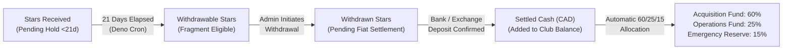

# LA CONFRÉRIE — Complete Platform: UG-01 → UG-04

> **Rebrand note (UG-04):** the club, formerly "Underground", is now **LA CONFRÉRIE** in every user-facing string (`CLUB_DISPLAY_NAME`). Internal identifiers, KV keys, cron job names, the repository name and the live BotFather username are intentionally unchanged. See [§14](#14-ug-04--la-confrérie-retro-vault-membership-tiers--migration).

A simple, secure, and reliable Telegram-native membership, creator directory, community voting, and treasury management bot built with TypeScript, [grammY](https://grammy.dev/), Deno 2, Deno KV, and Deno Cron for Deno Deploy.

LA CONFRÉRIE's bot automatically manages recurring Telegram Stars subscriptions, join request approvals for private spaces, automated member removals upon subscription expiration, administrator-granted complimentary memberships, public creator directory synchronization from private forum topics, member-governed acquisition voting, multi-currency treasury tracking with 21-day Stars holding periods, and subscriber-funded acquisition budgets.

---

## 1. Feature Status Matrix

In strict compliance with the UG-01, UG-02, and UG-03 Implementation Contracts:

| Component / Feature | Status | Notes |
|---|---|---|
| **Core Architecture & Extensible Provider Interface** | ✅ **Completed & Tested** | Domain separation: Member, Entitlement, Payment, Sync, Audit, Treasury. |
| **Deno KV Persistence & Atomic Transactions** | ✅ **Completed & Tested** | In-memory & Deno Deploy KV with race-safe atomic commits. |
| **Telegram Stars Recurring Payments (XTR)** | 🟡 **Implemented & Automated-Tested** | Validated with full mock suite; requires live BotFather Stars token for production billing. |
| **Payment Idempotency & Charge ID deduplication** | ✅ **Completed & Tested** | Duplicate payments cannot double-credit time or revenue. |
| **Pre-Checkout Verification** | ✅ **Completed & Tested** | Strict validation of payer, currency, price, and anti-duplicate check. |
| **Multi-Entitlement Resolution** | ✅ **Completed & Tested** | Overlapping entitlements coexist; expiring one preserves valid others. |
| **Secure Join-Request Space Access Control** | 🟡 **Implemented & Automated-Tested** | Links require bot approval; requires live Telegram chat admin permissions. |
| **Safe Member Removal (Ban & Immediate Unban)** | 🟡 **Implemented & Automated-Tested** | Expired non-admins removed without permanent blacklist; admins protected. |
| **Complimentary Memberships (7d, 30d, 90d, 365d)** | ✅ **Completed & Tested** | Full admin wizard, customizable reasons & space levels, audit logged. |
| **3-Day Expiry Reminder for Complimentary Members** | ✅ **Completed & Tested** | Automatically scheduled; single-delivery reminder with Stars purchase call-to-action. |
| **Hourly Scheduled Reconciliation (Deno Cron)** | ✅ **Completed & Tested** | Hourly job (`0 * * * *`) reconciles access states, closes expired ballots, advances 21d Stars, sends reminders. |
| **Member Inline Keyboard UI & Navigation** | ✅ **Completed & Tested** | Join, My Membership, Access Channels, Wanted List, Voting, Support (/paysupport). |
| **Administrator Private Menu & Lookup** | ✅ **Completed & Tested** | Whitelisted numeric user IDs; member lookup, complimentary wizard, creator registry, voting & treasury controls. |
| **Update Idempotency & Webhook Secret Token** | ✅ **Completed & Tested** | Prevents webhook spoofing and duplicate message processing. |
| **Creator Forum Topic Detection & Indexing (UG-02)** | ✅ **Completed & Tested** | Real-time topic creation/edit & photo/video detection; empty topics suppressed. |
| **Public Creator Directory Sync (UG-02)** | ✅ **Completed & Tested** | Daily 3:00 AM sync; separate Regular/Retro posts, linked names/counts, independent refreshes, <3500 char chunking. |
| **Deep Link Membership Protection (UG-02)** | ✅ **Completed & Tested** | `t.me/<bot>?start=creator_<id>`: direct private topic link for paid members, Stars CTA for non-members. |
| **Wanted List & Community Nominations (UG-02)** | ✅ **Completed & Tested** | `/suggest` and interactive voting; 1 support per paid member per monthly cycle. |
| **Monthly Acquisition Voting & Quorum (UG-02)** | ✅ **Completed & Tested** | Top 5 shortlisted candidates; irrevocable vote; 20% turnout check; auto 5-day tie runoffs. |
| **Telegram Stars Revenue Tracking & 21-Day Hold (UG-03)** | ✅ **Completed & Tested** | Strict separation: Pending (<21d), Withdrawable (>=21d), Withdrawn, and Settled cash. |
| **Multi-Currency Conversion & Integer Math (UG-03)** | ✅ **Completed & Tested** | CAD reporting base, integer minor units (cents), external rate API with KV fallback cache. |
| **Expense & Reimbursement Ledger (UG-03)** | ✅ **Completed & Tested** | Club vs personal outlay tracking, admin liabilities, auditable adjustments, recurring templates. |
| **Treasury Allocations (60/25/15) & Budgeting (UG-03)** | ✅ **Completed & Tested** | 60% Acquisitions, 25% Operations, 15% Reserve applied strictly to actual settled net receipts. |
| **Acquisition Budget & Voting Integration (UG-03)** | ✅ **Completed & Tested** | Candidate pricing in any currency, affordability checks, commitment reservation, post-vote purchases. |
| **Automated Monthly Treasury Reporting (UG-03)** | ✅ **Completed & Tested** | Transparent member report channel publication + detailed admin audit breakdown. |

---

## 2. Protected Telegram Architecture

LA CONFRÉRIE's bot manages access and synchronization across five Telegram spaces (four since UG-01, plus the UG-04 Retro forum):

| Name | Type | Access | Purpose |
|---|---|---|---|
| **Underground QC VIP** | Channel | Public | Welcome, announcements, subscription entry point |
| **Public Creator Directory** (`PUBLIC_DIRECTORY_CHAT_ID`) | Channel | Public | Separate alphabetical Regular/Retro directories with indexed content counts |
| **TOKEBEC VIP COLLECTIONS** (`VIP_COLLECTIONS_CHAT_ID`) | Forum Supergroup | Paid / Private | Primary creator media library (one topic per creator) |
| **Wanted List** (`WANTED_LIST_CHAT_ID`) | Channel | Paid / Private | Creator nominations, community rankings, and ballot announcements |
| **LA CONFRÉRIE General Chat** (`GENERAL_CHAT_ID`) | Supergroup | Paid / Private | Member conversations and optional weekly update digests |
| **LA CONFRÉRIE bot** | Bot | Hybrid | Automation, subscriptions, access gates, nominations, and voting |

### Access Levels
- **Paid Stars Subscription:** Full access to all 3 private spaces (`vip_collections`, `general_chat`, `wanted_list`) + nomination and voting rights.
- **Complimentary Access Levels:**
  - `vip_only`: Access to TOKEBEC VIP COLLECTIONS only (default).
  - `vip_and_chat`: Access to TOKEBEC VIP COLLECTIONS + LA CONFRÉRIE General Chat.
  - `regular`: Active creators and community, without Retro.
  - `full`: Full access to all 4 spaces, including Retro (nominations and voting require paid or content-earned access; older grants explicitly marked content_contribution also qualify).


---

## 3. Technology Stack & Repository Structure

- **Runtime:** [Deno 2](https://deno.com/) + [Deno Deploy](https://deno.com/deploy)
- **Framework:** [grammY v1.35+](https://grammy.dev/)
- **Database:** Deno KV (`Deno.openKv()`)
- **Scheduler:** Deno Cron (`Deno.cron()`)
- **Language:** TypeScript 6 (strict mode)

```
underground-manager/
├── deno.json              # Deno configuration, imports, unstable flags & task runners
├── .env.example           # Environment template without secrets
├── .gitignore             # Git exclusions
├── README.md              # Complete technical documentation & operational manual
├── src/
│   ├── config.ts          # Environment variables, chat mapping, price settings, validation
│   ├── types.ts           # Core domain models (Member, Entitlement, Creator, Wanted, Ballot, Treasury, Audit)
│   ├── main.ts            # Entry point: HTTP Webhook / Polling server + Deno.cron
│   ├── db/
│   │   ├── kv.ts          # Deno KV lifecycle and test injection
│   │   ├── members.ts     # Member persistence and username indexing
│   │   ├── entitlements.ts# Multi-entitlement resolution, expiry calculation, status
│   │   ├── payments.ts    # Transaction logs and atomic charge ID idempotency
│   │   ├── sync.ts        # Space admission/removal state tracking
│   │   ├── links.ts       # Cached join-request invite links
│   │   ├── creators.ts    # [UG-02] Creator topic indexing & media upload tracking
│   │   ├── directory.ts   # [UG-02] Public directory state, message chunking, content hash
│   │   ├── wanted.ts      # [UG-02] Candidate nominations, atomic monthly support, rankings
│   │   ├── voting.ts      # [UG-02] Ballots, atomic vote casting, tallies, runoff records
│   │   ├── settings.ts    # [UG-02] Dynamic operational settings persistence
│   │   ├── exchange_rates.ts # [UG-03] Multi-currency exchange rate storage & caching
│   │   ├── treasury.ts    # [UG-03] Stars holding, withdrawals, journal, allocations
│   │   ├── expenses.ts    # [UG-03] Expenses, commitments, reimbursements, recurring templates
│   │   └── audit.ts       # Immutable audit event log
│   ├── payments/
│   │   ├── provider.ts    # Generic PaymentProvider interface
│   │   └── stars.ts       # Telegram Stars recurring subscription implementation
│   ├── access/
│   │   ├── spaces.ts      # Space metadata and configuration lookups
│   │   ├── links.ts       # Join link generation with creates_join_request=true
│   │   ├── join_requests.ts # Join request verification and approval/decline
│   │   └── sync.ts        # Access synchronization, bot permission checks, safe removals
│   ├── creators/
│   │   └── service.ts     # [UG-02] Topic detection, media upload tracking, link matching
│   ├── directory/
│   │   └── sync.ts        # [UG-02] Public channel sync, separate collections, counts, deep linking
│   ├── wanted/
│   │   └── service.ts     # [UG-02] Nomination validation, duplicate checks, channel sync
│   ├── voting/
│   │   └── service.ts     # [UG-02] Ballot creation, turnout quorum, runoff scheduling
│   ├── treasury/
│   │   ├── conversion.ts  # [UG-03] Multi-currency conversion & integer arithmetic
│   │   ├── stars_tracking.ts # [UG-03] 21-day Stars holding period & reconciliation
│   │   ├── service.ts     # [UG-03] Overview, withdrawals, budgets & acquisition approvals
│   │   └── reports.ts     # [UG-03] Monthly transparent member & admin audit reporting
│   ├── complimentary/
│   │   └── service.ts     # Admin complimentary grants, revokes, and 3-day reminders
│   ├── cron/
│   │   └── reconciliation.ts # Hourly reconciliation, 21d Stars advance & daily 3:00 AM sync
│   └── bot/
│       ├── bot.ts         # GrammY bot assembly and error handling
│       ├── keyboards.ts   # Inline keyboards for members and administrators
│       ├── messages.ts    # Localization-ready text templates
│       ├── middleware/
│       │   ├── auth.ts    # Admin authorization and member tracking
│       │   └── idempotency.ts # Update ID deduplication
│       └── handlers/
│           ├── start.ts   # /start, /help, /paysupport, home navigation & deep links
│           ├── membership.ts # Join info, Stars invoice link, My Membership, channel links
│           ├── payments.ts# pre_checkout_query and message:successful_payment
│           ├── join_req.ts# chat_join_request verification
│           ├── forum.ts   # [UG-02] Forum topic created/edited & media upload listener
│           ├── wanted.ts  # [UG-02] /wanted, /suggest, and interactive support casting
│           ├── voting.ts  # [UG-02] /vote, candidate presentation, atomic confirmation
│           ├── treasury.ts# [UG-03] /treasury, expenses, withdrawals, reports, pricing
│           └── admin.ts   # Admin menu, complimentary wizard, creator & voting controls
└── tests/
    ├── test_helpers.ts    # In-memory Deno KV and MockTelegramApi
    ├── payments_test.ts   # 9 automated tests for Stars billing & idempotency
    ├── access_test.ts     # 9 automated tests for join requests & removal logic
    ├── complimentary_test.ts # 8 automated tests for complimentary workflow & reminders
    ├── security_test.ts   # 6 automated tests for webhook security, auth & concurrency
    ├── creators_test.ts   # 6 automated tests for creator topics & media tracking
    ├── directory_test.ts  # 4 automated tests for public directory synchronization
    ├── wanted_test.ts     # 7 automated tests for nominations & monthly support
    ├── voting_test.ts     # 5 automated tests for ballots, votes, quorum & runoffs
    ├── acquisitions_test.ts # 3 automated tests for post-acquisition transitions
    ├── treasury_stars_test.ts # [UG-03] 3 automated tests for Stars 21-day holding periods
    ├── treasury_conversion_test.ts # [UG-03] 4 automated tests for multi-currency conversion
    ├── treasury_expenses_test.ts # [UG-03] 4 automated tests for expenses & reimbursements
    ├── treasury_allocations_test.ts # [UG-03] 4 automated tests for 60/25/15 fund allocations
    ├── treasury_acquisitions_test.ts # [UG-03] 2 automated tests for candidate pricing & budget
    └── treasury_reports_test.ts # [UG-03] 4 automated tests for monthly treasury reports
```

---

## 4. Setup & Configuration Guide

### Step 1: Telegram BotFather Configuration
1. Open [@BotFather](https://t.me/BotFather) on Telegram.
2. Send `/newbot` and follow the instructions to create `@UndergroundManagerBot`. Save the resulting `BOT_TOKEN`.
3. Configure Bot Privacy:
   - Send `/setprivacy` -> Select your bot -> Choose **Disable** (required so the bot can receive join requests, admin commands, and forum topic service messages in groups).
4. Configure Bot Commands:
   - Send `/setcommands` -> Select your bot -> Paste:
     ```text
     start - Open LA CONFRÉRIE bot main menu
     help - How to use the bot and access channels
     wanted - Browse Wanted List & support creators
     recherches - Voir la liste recherchée des administrateurs
     suggest - Propose a new creator for the Wanted List
     vote - Cast your vote in the active monthly acquisition ballot
     treasury - View treasury balances, budget & reports (admins only)
     paysupport - Subscription billing help and support
     admin - Open Administrator controls (admins only)
     ```
5. Configure Telegram Stars:
   - In BotFather, navigate to **Bot Settings** > **Payments** > select your bot > enable **Telegram Stars**.
   - Note: Stars payments use `currency: "XTR"` and `provider_token: ""`.

### Step 2: Telegram Space Administrator Rights
Add your bot as an **Administrator** in all 4 spaces:
1. **TOKEBEC VIP COLLECTIONS** (Forum Supergroup):
   - Administrator Permissions Required:
     - `can_invite_users` (required to create invite links and approve join requests)
     - `can_restrict_members` (required to remove expired non-admin members)
     - `can_manage_topics` (required to detect and register forum topics)
2. **Public Creator Directory** (Public Channel):
   - Administrator Permissions Required:
     - `can_post_messages` (required to publish and update the directory)
     - `can_edit_messages` (required to update existing directory chunk messages)
     - `can_delete_messages` (required to clean up excess chunk messages)
3. **Wanted List** (Channel):
   - Administrator Permissions Required:
     - `can_invite_users`
     - `can_manage_chat`
     - `can_post_messages`
     - `can_edit_messages`
4. **LA CONFRÉRIE General Chat** (Group):
   - Administrator Permissions Required:
     - `can_invite_users`
     - `can_restrict_members`

> [!IMPORTANT]
> **Administrator Responsibilities:**
> - Ensure all manual invitation links created in Telegram chat settings are set to **Request Admin Approval**, or revoke any open unrestricted links.
> - The bot only approves users whose immutable Telegram numeric ID has an active entitlement.
> - The bot protects Telegram administrators and channel creators from ever being removed.

### Step 3: Determining Telegram Chat IDs
To find the numeric chat ID for each space:
1. Forward a message from each channel/group to [@userinfobot](https://t.me/userinfobot) or use Telegram Web (the URL contains the chat ID prefixed with `-100`).
2. Example IDs:
   - `VIP_COLLECTIONS_CHAT_ID=-1001234567890`
   - `PUBLIC_DIRECTORY_CHAT_ID=-1001234567893`
   - `WANTED_LIST_CHAT_ID=-1001234567891`
   - `GENERAL_CHAT_ID=-1001234567892`

---

## 5. Environment Variables Reference

Create a `.env` file for local development or set the following in Deno Deploy:

| Variable | Description | Example | Default |
|---|---|---|---|
| `BOT_TOKEN` | Bot API token from @BotFather | `123456:ABC-DEF1234ghIkl` | *Required* |
| `BOT_USERNAME` | Bot username without `@` (used for deep linking) | `UndergroundManagerBot` | `UndergroundManagerBot` |
| `WEBHOOK_SECRET` | Secret token for webhook verification (`X-Telegram-Bot-Api-Secret-Token`) | `f7a29...` | *Required in Prod* |
| `ADMIN_USER_IDS` | Comma-separated numeric Telegram user IDs of administrators | `12345678,87654321` | *Required* |
| `VIP_COLLECTIONS_CHAT_ID` | Numeric Chat ID for the Regular forum (TOKEBEC VIP COLLECTIONS) | `-1001234567890` | *Required* |
| `TELEGRAM_RETRO_FORUM_CHAT_ID` | **UG-04** Chat ID for the private `RETRO \| LA CONFRÉRIE` forum | `-1003975562920` | `0` (Retro tier off) |
| `CLUB_DISPLAY_NAME` | **UG-04** Public club name used in all user-facing text | `LA CONFRÉRIE` | `LA CONFRÉRIE` |
| `RETRO_PLUS_STARS_PRICE_AMOUNT` | Retro Plus price in Stars per 30 days. Unset/blank defaults to 1,200; explicit `0` disables billing | Optional | `1200` |
| `MIGRATION_BATCH_SIZE` | **UG-04** Max message IDs per `copyMessages` call (1–100) | `30` | `30` |
| `MIGRATION_BATCH_DELAY_MS` | **UG-04** Pause between copy batches (rate-limit friendly) | `3000` | `3000` |
| `PUBLIC_DIRECTORY_CHAT_ID` | Numeric Chat ID for Public Creator Directory channel | `-1001234567893` | `0` |
| `WANTED_LIST_CHAT_ID` | Numeric Chat ID for Wanted List channel | `-1001234567891` | *Required* |
| `GENERAL_CHAT_ID` | Numeric Chat ID for General Chat | `-1001234567892` | *Required* |
| `STARS_PRICE_AMOUNT` | Price in Telegram Stars for the **Regular** recurring subscription | `750` | `750` |
| `STARS_SUBSCRIPTION_PERIOD_SECONDS` | Recurring subscription duration in seconds | `2592000` (30 days) | `2592000` |
| `CURRENCY` | Currency code for Stars | `XTR` | `XTR` |
| `DIRECTORY_UPDATE_CRON` | Daily Directory & Wanted List sync cron expression | `0 3 * * *` | `0 3 * * *` |
| `VOTING_PERIOD_DAYS` | Monthly acquisition voting period duration in days | `5` | `5` |
| `VOTING_SHORTLIST_SIZE` | Maximum top candidates included on monthly ballot | `5` | `5` |
| `DIGEST_ENABLED` | Enable weekly creator update digest in General Chat | `false` | `false` |
| `BASE_CURRENCY` | Base reporting currency for treasury | `CAD` | `CAD` |
| `DEFAULT_STARS_REWARD_VALUATION_USD` | Configurable valuation assumption for 1 Telegram Star in USD | `0.013` | `0.013` |
| `TREASURY_REPORT_CHANNEL_ID` | Channel ID for monthly report publication (or 0 for Wanted List) | `-1001234567891` | `0` |
| `EXCHANGE_RATE_API_URL` | Public endpoint for fiat exchange rates | `https://open.er-api.com/v6/latest/USD` | `https://open.er-api.com/v6/latest/USD` |
| `BOT_MODE` | Runtime mode: `webhook` (Deploy) or `polling` (Local) | `webhook` | `webhook` |
| `PORT` | HTTP listener port | `8000` | `8000` |
| `DENO_ENV` | Environment: `production`, `development`, or `test` | `production` | `development` |
| `SUPPORT_USERNAME` | Support handle displayed in `/paysupport` | `@UndergroundSupport` | `@UndergroundSupport` |


---

## 6. Deno Deploy Deployment

1. **Push Repository to GitHub:**
   ```bash
   git remote add origin https://github.com/your-org/underground-manager.git
   git push -u origin main
   ```
2. **Create Project in Deno Deploy:**
   - Log into [Deno Deploy Console](https://dash.deno.com/).
   - Click **New Project** and link your GitHub repository.
   - Entry point: `src/main.ts`.
3. **Configure Environment Variables:**
   - In project settings, add all environment variables defined above.
4. **Deno KV & Deno Cron Integration:**
   - Deno KV and Deno Cron are enabled automatically by Deno Deploy.
5. **Set Telegram Webhook:**
   - Once your project is deployed at `https://your-project.deno.dev`, set the Telegram webhook via browser or curl:
   ```bash
   curl -F "url=https://your-project.deno.dev/webhook" \
        -F "secret_token=YOUR_WEBHOOK_SECRET" \
        -F "allowed_updates=[\"message\",\"callback_query\",\"chat_join_request\",\"pre_checkout_query\"]" \
        https://api.telegram.org/bot<BOT_TOKEN>/setWebhook
   ```
6. **Verify Deployment:**
   - Visit `https://your-project.deno.dev/health` -> should return `{"status":"ok","app":"underground-manager"}`.

---

## 7. Local Development & Testing

### Running Tests
The project includes a comprehensive, automated test suite covering **78 test cases across 15 test suites** (Payments, Access Control, Complimentary Memberships, Security, Creators, Directory Sync, Wanted List, Voting, Acquisitions, Stars 21-day holding, Currency Conversion, Expenses, Allocations, Acquisition Budgets, and Monthly Reports):

```bash
deno task test
```

### Static Type-Checking
Verify clean compilation across all application modules and test files:
```bash
deno task check
```

### Running Locally with Long Polling
For local development without exposing a public webhook URL:
```bash
BOT_MODE=polling deno task dev
```

---

## 8. Administrator Playbook

Administrators (whose Telegram user ID is listed in `ADMIN_USER_IDS`) have access to `/admin` and `/treasury`.

### Granting Complimentary Access
1. Member starts the bot (`/start`) so their Telegram ID is registered.
2. Admin opens `/admin` > **Grant Complimentary Access** (or executes `/grant <userId> [days]`).
3. Admin selects:
   - **Duration:** 7 Days, 30 Days (default), 90 Days, or 365 Days.
   - **Reason:** Content contribution, Partnership, Promotion, or Administrator exception.
   - **Space Access Level:**
     - VIP Collections Only (Default)
     - VIP Collections + General Chat
     - Full Access (VIP + Chat + Wanted List)
4. Admin confirms the grant. The bot activates the entitlement immediately and notifies the member with direct channel access buttons.

### Member Lookup
Send `/lookup <userId>` or `/lookup @username`:
- Displays registered name, registration timestamp, active membership type, expiration date, and full entitlement history.
- Provides quick buttons to extend or revoke access.

### Access Synchronization & Emergency Resync
- Access reconciliation runs automatically every hour via Deno Cron.
- Admins can trigger an immediate manual reconciliation anytime via `/admin` > **System Status** > **Trigger Safe Resync**.
- The bot checks each member against active database entitlements. If expired, it kicks them without permanently banning them, allowing seamless re-entry upon future payment.

### Creator Registration & Topic Repair
LA CONFRÉRIE bot automatically detects new forum topics and topic renames in `TOKEBEC VIP COLLECTIONS`. If a topic was created prior to bot installation or an event was missed:
- Command: `/register_creator <Creator Name> <Topic Thread ID>`
- Example: `/register_creator Aria 42`
- Or use `/admin` > **Creator Management** to view all registered creators and trigger an immediate directory refresh.

### Wanted List Administration
- View ranked nominations via `/admin` > **Wanted List Admin**.
- Admins can mark candidates as acquired, reject proposals, or merge duplicate suggestions.
- Trigger manual Wanted List channel sync anytime via the admin menu.

### Acquisition Voting Administration
- Inspect the active monthly ballot and real-time tallies via `/admin` > **Voting Admin**.
- Manually create or close ballots when needed.
- If a ballot ends in a tie between top candidates, the bot automatically schedules a 5-day runoff ballot.

### Treasury & Financial Management (UG-03)
- Command: `/treasury` opens the real-time financial ledger and balances overview.
- Record Expense: `/record_expense <amount> <currency> <category> <payer> <description>`
  - Example: `/record_expense 16.00 CAD creator_subscription club_funds Aria OnlyFans`
- Record Withdrawal & Settlement: `/record_withdrawal <stars> <tonReceived> [netCadSettled]`
  - Example: `/record_withdrawal 5000 12.5 85.00`
- Reconcile Stars Holding Periods: `/reconcile_stars` advances 21-day holding periods and fetches new API transactions.
- Set Candidate Price: `/price <candidateId> <amount> [currency]`
  - Example: `/price 1234-abcd 25.00 USD` (automatically converts to CAD and evaluates affordability against available budget).
- View & Publish Monthly Reports: via `/treasury` > **Monthly Reports** or `/treasury_report`.

---

## 9. Creator Directory & Forum Synchronization (UG-02)

### Topic Detection & Media Indexing
1. **New Topics:** When an administrator creates a new topic in **TOKEBEC VIP COLLECTIONS**, the bot detects `message:forum_topic_created` and creates a creator record (`hasContent: false`).
2. **Topic Renames:** When a topic is renamed, `message:forum_topic_edited` updates the creator's display name without altering historical records or creating duplicate profiles.
3. **Media Uploads:** When authorized administrators upload photos or videos into a topic thread:
   - The bot records the upload timestamp as `lastContentUpdateAt`.
   - The creator is marked as `hasContent: true`.
   - Text messages, reactions, and uploads from non-administrators do not affect the update timestamp.
4. **Empty Topic Suppression:** Empty topics (`hasContent: false`) are kept internally but omitted from the public directory until media is published.

### Public Directory Channel (`PUBLIC_DIRECTORY_CHAT_ID`)
- **Daily Synchronization:** One hourly `Deno.cron` (UTC) drives all jobs; the daily directory/Wanted/Stars-ledger sync runs at the first hourly tick at or after 03:00 America/Toronto (DST-safe, caught up if missed, at most once per local day). `DIRECTORY_UPDATE_CRON` is only read for its hour field (default `0 3 * * *` = 03:00 Toronto).
- **Compact Alphabetical Lists:** Regular and Retro are separate messages with their own refresh buttons. Each row is a linked creator name and indexed content count. The introduction includes a copyable join link.
- **Message Chunking:** Telegram messages are limited to 4,096 characters. The sync engine automatically chunks entries into clean posts under 3,500 characters and updates existing channel messages by ID.
- **Content Hashing:** The directory computes an SHA-256 hash of the generated content. If no creator updates have occurred, Telegram API calls are skipped.
- **Privacy Protection:** The public directory never leaks private Telegram join links or media files. Instead, each creator links to a deep link:
  ```text
  https://t.me/<BOT_USERNAME>?start=creator_<creatorId>
  ```

### Deep Link Protection
When a user clicks a creator deep link in the public directory:
- **Active Paying Member:** The bot verifies active entitlement and displays a direct button linking to the private topic (`https://t.me/c/<clean_chat_id>/<topicId>`).
- **Non-Member / Expired Member:** The bot presents a preview and a call-to-action to subscribe via Telegram Stars.

---

## 10. Wanted List & Community Acquisition Voting (UG-02)

### Community Nominations
- Members with active paid or content-earned access can propose creators using `/suggest <Creator Name> [optional URL/notes]`.
- Suggestions are validated (minimum 2 characters, alphanumeric filtering, duplicate detection).
- Successfully submitted suggestions appear in the private **Wanted List** channel (`WANTED_LIST_CHAT_ID`) sorted by member support.
- Complimentary members can view the Wanted List channel, but are blocked from nominating or voting to maintain subscriber economic governance.

### Monthly Support Cycles
- Each calendar month forms a distinct support cycle (e.g. `2026-10`).
- Each member with active paid or content-earned access may support **one** candidate per monthly cycle.
- Support casting is atomic and updates the candidate's monthly score.

### Monthly Acquisition Voting
1. **Shortlist Selection:** At the end of each cycle, the bot selects the top candidates (default 5) by support count.
2. **Ballot Creation:** A formal acquisition ballot is opened for voting (default duration: 5 days).
3. **Voting Interface (`/vote`):**
   - Members with active paid or content-earned access cast one irrevocable vote.
   - Candidate options are randomized per session to prevent positional voting bias.
   - Votes are recorded atomically (`votes_by_ballot_user` KV key).
4. **Quorum & Closure:**
   - When the voting window expires (checked hourly via Deno Cron), the ballot closes automatically.
   - The engine checks member turnout against the 20% active subscriber quorum.
   - If quorum is met, the winning creator is announced and transitions to `approved`.
   - In the event of a first-place tie, the engine automatically creates a 5-day runoff ballot between the tied candidates.
5. **Acquisition Completion:** When administrators acquire the winning creator and create their topic in TOKEBEC VIP COLLECTIONS, the candidate automatically transitions to `acquired` and links to the creator profile.

---

## 11. Treasury, Multi-Currency Conversion & Acquisition Budgeting (UG-03)

### Core Financial Principle: Telegram Stars Are Not Cash
Telegram Stars (`XTR`) are virtual reward units, not immediate fiat money. Under Telegram's terms:
- Stars received are held in a mandatory **21-day holding period** before becoming eligible for withdrawal.
- Withdrawal eligibility does not guarantee a fixed fiat amount; conversion depends on Fragment withdrawal rates, network fees, and fiat exchange rates.
- **The bot strictly enforces separation between Stars and Cash.** Pending or withdrawable Stars are never combined with fiat balances or counted as spendable cash.



### Multi-Currency Integer Mathematics
To prevent floating-point calculation errors:
- All fiat money is calculated and stored in **integer minor units** (e.g. cents: `$15.50 CAD` = `1550` minor units).
- Supported currencies: **CAD** (base reporting currency), **USD**, **EUR**, **TON**, and **XTR** (Telegram Stars).
- Conversion uses cached exchange rates (`rates` KV namespace) fetched from open exchange rate APIs with offline fallbacks and administrator manual overrides (`setExchangeRate`).

### Fund Allocations (60 / 25 / 15)
When Stars withdrawals settle into verified fiat cash, the net received amount is allocated into three distinct sub-funds:
1. **Acquisitions Fund (60%):** Dedicated exclusively to purchasing creator content, OnlyFans subscriptions, pay-per-view sets, and custom acquisition packs.
2. **Operations & Maintenance (25%):** Covers bot hosting, proxy/VPN infrastructure, database costs, and operational tools.
3. **Emergency Reserve (15%):** Retained for unexpected expenses, fee fluctuations, or reserve cushion.

> **Integrity Rule:** Allocation percentages are strictly verified to total 100%. Allocations are applied **only to settled cash proceeds**, never to unvested or pending Telegram Stars.

### Available Acquisition Budget & Commitments
To prevent overspending on creator purchases:
$$\text{Available Acquisition Budget} = \max(0, \text{Allocated}_{\text{Acquisitions}} - \text{Paid}_{\text{Acquisitions}} - \text{Committed}_{\text{Acquisitions}})$$

- **Commitment Reservation:** When a candidate wins a monthly vote and is approved for purchase, their expected price is recorded as a `committed` expense. This immediately reduces the Available Acquisition Budget without prematurely deducting cash balance.
- **Purchase Confirmation:** When the content is acquired, the commitment transitions to a `paid` expense. Settled cash is debited and the commitment is released, preventing double-subtraction.

### Expense Management & Payer Tracking
Administrators record expenses directly in Telegram via `/record_expense`:
- **Club Funds (`club_funds`):** Directly debits settled cash and the corresponding allocation fund (e.g. acquisitions or operations).
- **Admin Personal Outlay (`admin_personal`):** When an administrator pays out of pocket, the expense is recorded, allocated to the category, and credited to `admin_liability` without decreasing club cash.
- **Reimbursement Workflow:** When the club reimburses the administrator, the liability is settled and cash is debited (`/treasury` -> Reimbursements).
- **Auditable Adjustments:** Finalized expense records are immutable. Adjustments create linked audit entries (`adjusted_from_expense_id`), preserving full audit trails.

### Automated Monthly Reporting
At the end of each calendar month (or on-demand via `/treasury_report`):
1. **Transparent Member Report:** Published to the community chat or VIP channel, detailing:
   - Total active paying members and community growth
   - Total Telegram Stars collected during the month
   - Settled club cash revenue and allocation breakdown
   - Community acquisition budget and list of acquired creators
   - Operations and hosting expenses summary
2. **Detailed Administrator Audit:** Sent directly to administrators, detailing exact transaction IDs, exchange rates used, pending Stars vesting schedule, individual expense ledger, and pending reimbursement liabilities.

---

## 12. Complete Testing & Verification Matrix

LA CONFRÉRIE's bot features a comprehensive automated test suite consisting of **234 tests** (UG-01…UG-03, the post-audit E2E/regression suites, 59 for UG-04 and 41 for UG-05) running on Deno's native test runner (`deno test -A`):

| Test Suite File | Tests | Domain / Coverage |
|---|:---:|---|
| [`tests/payments_test.ts`](file:///Users/goon/Desktop/ANTIGRAVITY%20PROJECTS/underground-manager/tests/payments_test.ts) | 9 | Pre-checkout validation, idempotency, subscription renewals, cancellations, refunds. |
| [`tests/access_test.ts`](file:///Users/goon/Desktop/ANTIGRAVITY%20PROJECTS/underground-manager/tests/access_test.ts) | 9 | Chat join request verification, safe ban/unban removal, admin immunity, multi-space gates. |
| [`tests/complimentary_test.ts`](file:///Users/goon/Desktop/ANTIGRAVITY%20PROJECTS/underground-manager/tests/complimentary_test.ts) | 8 | Complimentary access levels, duration calculation, manual revocation, 3-day reminder delivery. |
| [`tests/security_test.ts`](file:///Users/goon/Desktop/ANTIGRAVITY%20PROJECTS/underground-manager/tests/security_test.ts) | 6 | Webhook secret token validation, update deduplication, admin RBAC, concurrent transaction isolation. |
| [`tests/creators_test.ts`](file:///Users/goon/Desktop/ANTIGRAVITY%20PROJECTS/underground-manager/tests/creators_test.ts) | 6 | Forum topic creation/renaming, media upload detection, non-admin filtering, empty topic suppression. |
| [`tests/directory_test.ts`](file:///Users/goon/Desktop/ANTIGRAVITY%20PROJECTS/underground-manager/tests/directory_test.ts) | 4 | Separate alphabetical lists, synchronization, SHA-256 diffing and member access. |
| [`tests/wanted_test.ts`](file:///Users/goon/Desktop/ANTIGRAVITY%20PROJECTS/underground-manager/tests/wanted_test.ts) | 7 | Member nominations, alphanumeric validation, 1-per-cycle support limits, community ranking sort. |
| [`tests/voting_test.ts`](file:///Users/goon/Desktop/ANTIGRAVITY%20PROJECTS/underground-manager/tests/voting_test.ts) | 5 | Monthly acquisition ballots, irrevocable voting, 20% quorum enforcement, tie runoff ballots. |
| [`tests/acquisitions_test.ts`](file:///Users/goon/Desktop/ANTIGRAVITY%20PROJECTS/underground-manager/tests/acquisitions_test.ts) | 3 | Post-acquisition topic linking, candidate status progression, directory integration. |
| [`tests/treasury_stars_test.ts`](file:///Users/goon/Desktop/ANTIGRAVITY%20PROJECTS/underground-manager/tests/treasury_stars_test.ts) | 3 | Real-time Stars payment capture, 21-day holding period calculation, withdrawable status advancement. |
| [`tests/treasury_conversion_test.ts`](file:///Users/goon/Desktop/ANTIGRAVITY%20PROJECTS/underground-manager/tests/treasury_conversion_test.ts) | 4 | Integer minor unit arithmetic, CAD/USD/EUR/TON cross-rates, indicative Stars valuation. |
| [`tests/treasury_expenses_test.ts`](file:///Users/goon/Desktop/ANTIGRAVITY%20PROJECTS/underground-manager/tests/treasury_expenses_test.ts) | 4 | Club funds vs admin outlays, reimbursement liability clearance, immutable adjustments, recurring templates. |
| [`tests/treasury_allocations_test.ts`](file:///Users/goon/Desktop/ANTIGRAVITY%20PROJECTS/underground-manager/tests/treasury_allocations_test.ts) | 4 | Strict 100% allocation validation, zero unvested Stars leak into cash, 60/25/15 fund credit, double-spend prevention. |
| [`tests/treasury_acquisitions_test.ts`](file:///Users/goon/Desktop/ANTIGRAVITY%20PROJECTS/underground-manager/tests/treasury_acquisitions_test.ts) | 2 | Candidate pricing in foreign currencies, affordability checks against available budget, commitment to paid lifecycle. |
| [`tests/treasury_reports_test.ts`](file:///Users/goon/Desktop/ANTIGRAVITY%20PROJECTS/underground-manager/tests/treasury_reports_test.ts) | 4 | Monthly report generation, member transparency formatting, admin audit breakdown, channel publication. |
| `tests/ug04_membership_test.ts` | 15 | Rebrand, two tiers, plan-aware billing, invite-link gating, upgrade/downgrade, legacy subscriptions, tier revenue. |
| `tests/ug04_directory_test.ts` | 9 | Separate directories/filters, retro topic registration, no duplicates, media-ID inventory, repair. |
| `tests/directory_split_test.ts` | 6 | Current-topic counts, independent refreshes, legacy upgrade, row chunking, retry/concurrency checkpoints and bot routing. |
| `tests/ug04_migration_test.ts` | 21 | Dry-run, protected content, albums, partial failure, resume, rate limits, leases, finalization, deletion safeguards. |
| `tests/ug04_bot_routing_test.ts` | 6 | Real bot wiring: menus, admin-only routes, tier-gated deep links, disabled Retro checkout. |
| `tests/ug04_contributions_test.ts` | 8 | Admin-reviewed member contributions: review gate, single publish, partial failure, migration hold, bot wiring. |
| `tests/ug05_contributions_test.ts` | 27 | Reward / no-reward approval, scopes, durations, accumulation, idempotency, partial/failed publication, new creators, admin UI wiring. |
| `tests/ug05_navigation_test.ts` | 14 | Acquisition modes, welcome/lobby/directory navigation, deep links, private-space safety. |
| **Total** | **234** | **All 234 Tests Passing** |

To run the full suite:
```bash
deno task check  # Strict TypeScript type check
deno task test   # Runs all 234 unit, integration and security tests
```

---

## 13. Administrator Financial & Operational Runbook

### Quick Command Reference
| Command | Usage | Description |
|---|---|---|
| `/treasury` | `/treasury` | Opens real-time balance sheet, allocation pools, and action menu. |
| `/record_expense` | `/record_expense <amount> <currency> <category> <payer> <description>` | Records an operational or creator acquisition expense. |
| `/record_withdrawal` | `/record_withdrawal <stars> <ton> [netCad]` | Records a Telegram Stars withdrawal and fiat cash settlement. |
| `/reconcile_stars` | `/reconcile_stars` | Scans for newly vested Stars past the 21-day holding period. |
| `/price` | `/price <candidateId> <amount> [currency]` | Sets purchase price for a Wanted List creator candidate. |
| `/treasury_report` | `/treasury_report [YYYY-MM]` | Generates and previews the monthly financial report. |

### Common Operational Scenarios

#### Scenario A: Recording a Creator Purchase from Club Funds
1. Admin purchases OnlyFans set for Aria for \$25.00 CAD using club debit card.
2. Send to bot:
   ```text
   /record_expense 25.00 CAD creator_ppv club_funds Aria custom pack
   ```
3. The bot immediately debits \$25.00 CAD from `settled_cash` and `acquisition_fund`, and links the expense to the creator.

#### Scenario B: Admin Pays Out-of-Pocket for Bot Hosting
1. Admin pays \$15.00 USD from personal credit card for Deno Deploy / domain.
2. Send to bot:
   ```text
   /record_expense 15.00 USD bot_hosting admin_personal Deno Deploy annual renewal
   ```
3. The bot converts \$15.00 USD to CAD (e.g. \$20.25 CAD), debits the `operations_fund`, and credits \$20.25 CAD to `admin_liability` without decreasing club cash.
4. When club funds are transferred to the admin:
   - Admin opens `/treasury` -> **Admin Liabilities** -> Select expense -> **Reimburse**.
   - The liability is cleared and cash is debited.

#### Scenario C: Processing a Telegram Stars Withdrawal
1. Over 21 days have elapsed; bot reports 10,000 Stars eligible for withdrawal.
2. Admin requests withdrawal via Telegram Stars / Fragment to TON wallet, receiving 18.2 TON.
3. TON is sold on an exchange and \$175.50 CAD arrives in the club's bank account.
4. Send to bot:
   ```text
   /record_withdrawal 10000 18.2 175.50
   ```
5. The bot updates 10,000 Stars from `withdrawable_estimate` to `settled_cash`, credits \$175.50 CAD to total club cash, and automatically allocates:
   - **Acquisitions Fund (60%):** +$105.30 CAD
   - **Operations Fund (25%):** +$43.88 CAD
   - **Emergency Reserve (15%):** +$26.32 CAD

---

## 14. UG-04 — LA CONFRÉRIE: Retro Vault, Membership Tiers & Migration

### 14.1 Plans

| | Regular | Retro Plus |
|---|:---:|:---:|
| Regular vault (TOKEBEC VIP COLLECTIONS) | ✅ | ✅ |
| **RETRO \| LA CONFRÉRIE** vault | ❌ | ✅ |
| Wanted List · General Chat · Nominations & voting | ✅ | ✅ |
| Price | `STARS_PRICE_AMOUNT` (unchanged) | `RETRO_PLUS_STARS_PRICE_AMOUNT` |

* Both are recurring 30-day Telegram Stars subscriptions handled by the existing payment engine. The purchased plan is stored on the payment and entitlement (`planId` / `plan`); records without it are **Regular** (legacy-safe).
* **Retro Plus costs 1,200 Stars per 30 days by default.** `RETRO_PLUS_STARS_PRICE_AMOUNT` can override this; explicit `0` disables billing. The Retro forum must also be configured, and Stars checkout must be enabled by the membership mode. Invoice creation and pre-checkout use the same configured price.
* Access is still decided only by entitlement `spaces`. Every invite link is a **join-request link**: the bot approves a request only if the user holds an active entitlement for that space, so an old or shared Retro link is useless to a Regular member. Hourly reconciliation covers the Retro forum and removes a user from Retro only, leaving valid Regular access intact.
* Complimentary grants keep their existing levels; a new optional level **Full Access + Retro Vault** exists for admins.

### 14.2 Upgrades and downgrades (no invented proration)

Telegram Stars cannot prorate, so plan changes are a transparent cancel-and-resubscribe:

* **Regular → Retro Plus:** the member sees the full Retro price, that Retro starts the moment Telegram confirms payment, and that already-paid Regular access is kept. They choose whether to cancel Regular's renewal. The bot cancels it (Bot API `editUserStarSubscription`) **only after the Retro Plus payment is verified** and **only if they chose that**. If the API call fails they are told to cancel in *Settings → Stars*.
* **Retro Plus → Regular:** on confirmation the Retro renewal is cancelled; Retro stays until the paid-through date, then expires. A Regular purchase is blocked while Retro Plus is active (prevents overlapping charges).
* Nothing is ever cancelled without the member's explicit confirmation.

### 14.3 Creator directories

One `creators` collection. Each creator has a stable internal ID, `collection` (`regular`/`retro`), forum chat + topic ID, last content update, optional `retiredAt`, `rightsStatus`, and an inventory state.

The public channel has **separate Regular and Retro messages**, each with its own **Actualiser — en activité / Actualiser — inactifs** button. Admin → Répertoire also has separate refresh actions; the daily synchronization covers both. The first synchronization after upgrading converts existing combined posts into Regular posts and creates the separate Retro posts. Each collection keeps its own message IDs, content hash, and retry checkpoints. Concurrent refreshes are serialized; refreshing one collection leaves the other collection's pending changes intact.

Each message starts with “Voici la liste des créateurs toujours en activité que nous avons chez LA CONFRÉRIE” (Retro: “Voici la liste des créateurs qui ne sont plus en activité que nous avons chez LA CONFRÉRIE”) and the linked words **Rejoindre la plateforme** pointing to `https://t.me/<bot>?start=join`, so the formatted message can be copied or forwarded to invite people. Names are alphabetical, one linked name per line with a content count, e.g. `Aria (125)`. Dates, repeated tier labels and separate “Voir” links are omitted. Large lists split between complete creator rows, below 3,500 characters per message, with the invitation repeated on each chunk.

Directory messages use plain text with explicit Telegram text-link entities, so underscores in bot usernames and punctuation in creator names never turn into formatting or visible Markdown links. Private bot views keep a compact filter panel and display both collections as separate replies, reusing those replies when refreshed. Administrators have a separate **Actualiser le canal** action on each collection view; browsing a list and publishing it to the channel are distinct actions. Admin → Répertoire and sync confirmations provide links to the actual channel posts, including continuation chunks. Sync edits those posts in place; it does not append duplicate posts on every click. `/sync_directory` updates both collections, and `/sync_directory regular` or `/sync_directory retro` updates only one.

Channel checkpoints include the rendering version and destination channel. Production upgrades the actual channel on startup, and a minute worker retries pending changes; the daily sync still maintains time-sensitive badges. Deno `preview/*` and `git-branch/*` timelines serve health checks only: they never construct the bot, open its database, accept webhook updates or register scheduled jobs. This prevents preview warmups with empty databases and inherited live credentials from publishing empty directories. If an old trailing post cannot be deleted, the bot edits it into a short pointer to the pinned directories instead of leaving the old list or blocking the refresh.

Counts come from indexed content messages in the creator's **current forum/topic**, counting each album item once. A complete inventory displays `(125)`; an incomplete inventory displays `(125+)`; an unknown total displays `(?)`. Telegram's Bot API cannot fetch a topic's full history or report arbitrary manual message deletions, so these are inventory counts, not a live recount of Telegram history. Authorized uploads, approved contributions, completed imports, manual `/index_media`, and bot-managed import undo update the inventory. Use **Admin → Répertoire → Vérifier les compteurs** to find unknown/partial inventories and open a creator-specific guide with their topic link and copyable `/index_media` and `/attest_inventory` commands. Index the links of ALL older media, then attest only once the inventory is complete; refreshing alone cannot recover unseen history. This automatically updates the directory. Empty, archived and retired creators are excluded.

Members can filter **All / Regular / Retro** in the bot; All sends the two collections as distinct messages. The public directory contains only bot deep links; the protected topic link is given by `/start creator_<id>` **after** checking the tier (Retro needs Retro Plus).

### 14.4 Regular → Retro migration

Admin menu → **Move to Retro** (or Creators → *View Creators* → creator → *Move to Retro*).

1. **Prepare (dry-run)** – you confirm the club holds publication/distribution rights. The bot checks source mapping, Retro configuration, content protection and bot rights, counts the indexed messages/albums and estimates batches. **Nothing is copied or created.**
2. **Start copying** – creates the Retro topic once, then copies in album-safe batches with `copyMessages` (≤ `MIGRATION_BATCH_SIZE` ids, ascending, captions kept) into it. Source→destination message mappings are stored. A cron worker (every 5 min) and the *Copy next batches* button continue running jobs; 429 rate limits back off automatically. Pause/resume/cancel any time; retries skip verified copies; a per-job lease stops duplicate runs.
3. **Verify** – inventory vs copies, album contiguity, destination topic, rights. Any unaccounted item ⇒ **Needs review**; a migration with unaccounted media can never finalize.
4. **Approve finalization** – re-verifies, then points the *existing* creator record at the Retro topic (ID, nominations, acquisition links and last-update timestamp unchanged; no duplicate) and refreshes the directory.
5. **Remove old Regular topic** (optional, separate, destructive) – step 1: you attest you manually reviewed the Retro topic (exact source forum/topic/results are shown); step 2 (valid 10 min): final delete. Refused if any discrepancy remains. Who/when is audited. **Never automatic.**

Until step 5, Regular members can still open the original Regular topic — **exclusive Retro access is not achieved until the original content is removed or otherwise secured.** The bot warns about this on every migration screen.

#### What Telegram does and does not allow
* **Restrict Saving Content** blocks `copyMessages`. The bot detects it (preflight `getChat.has_protected_content`, and the API refusal) and stops. It never disables protection and never downloads/scrapes. **Fallback (administrator-controlled republishing):** upload the media from authorized source files into the creator's Retro topic yourself, then link it with `/relink_creator <creator> <retro topic id>` (same creator record, rights must be verified).
* The Bot API **cannot list a topic's history**. The bot only knows messages it saw an admin upload since UG-04 (IDs only, no media stored). Creators registered before UG-04 are flagged *inventory not confirmed complete* and **blocked** until you index older media with `/index_media <creator> <t.me/c/…/topic/msg links…>` (the topic in each link must match the creator's topic) and attest with `/attest_inventory <creator>`.
* `copyMessages` returns only the new message IDs. If any message in a batch was skipped (e.g. deleted), Telegram doesn't say which, so those items are marked **ambiguous**, are *not* retried (duplicate risk) and need your review (*Exclude unresolved…* records your acceptance).
* Admin commands: `/move_to_retro`, `/index_media`, `/attest_inventory`, `/retire_creator`, `/relink_creator`.

### 14.5 Treasury

One consolidated treasury. Reports add **Subscription revenue by tier** from completed, de-duplicated payments (an upgrade is a new Retro Plus charge — the earlier Regular charge is never moved or re-counted; refunds and complimentary grants are excluded; active subscribers are counted once, under their highest tier). Pending-Stars, expense, conversion and allocation rules are untouched.

### 14.6 Live setup checklist for `RETRO | LA CONFRÉRIE` (`-1003975562920`)

The bot must be an **administrator** of the Retro forum with: *Invite users via link*, *Ban users* (restrict members), *Manage topics*, *Post messages*, and *Delete messages* (only needed if you later use deletion cleanup). The forum must have **Topics** enabled. Then run `deno task verify` (read-only). Also:

* Set `TELEGRAM_RETRO_FORUM_CHAT_ID=-1003975562920` in Deno Deploy (Project → Settings → Environment Variables); keep `.env` out of Git.
* **BotFather (only if you want a new public bot name):** `/setname` → pick the bot → `LA CONFRÉRIE`; optionally `/setdescription`, `/setabouttext`, `/setuserpic`. Do **not** change the username (`/setusername`) unless you also update `BOT_USERNAME` and accept that existing `t.me/<bot>` links stop working.
* Do not rename live channels/groups unless you want to; the bot reads titles only for display.


### 14.7 Member contributions (admin-reviewed)

Main menu → **➕ Contribute** → pick a creator → send photos/videos (albums OK, no item cap) → **Finish**. Open to any bot user, no credit tracking. Admins receive a preview plus **Approve & publish / Reject** buttons (also under Admin → **📥 Contributions**). On approval the *bot* copies the items into the creator's topic (`copyMessages`), so the posts are the bot's and cannot be deleted by the contributor; the media inventory and the creator's last-update date are updated. Only message IDs are stored. Approval is single-use, held while that creator is being migrated, and reported as *needs review* if originals were deleted before approval.

---

## 15. UG-05 — Community Contributions, Earned Memberships & Public Discovery

### 15.1 Earned access (`contribution` entitlement source)
* Anyone using the bot can contribute (no membership needed). Submitting never grants access.
* For every submission an administrator makes **two separate decisions**: (1) publish or reject, (2) reward or not.
  * **Approve & Reward** → choose access *Regular only / Retro only / Both* (never preselected — a Retro creator does **not** imply Retro access) and duration *7 / 15 / 30 (default) / 60 / 90 / custom* days.
  * **Approve Without Reward** → publish only; nothing is granted.
  * **Reject** → optional reason; nothing is published or granted; message references are purged (only a count is kept).
* Full access includes both Regular and Retro plus the community. The Regular-only option explicitly excludes Retro. At startup, an idempotent repair adds missing Retro access to still-active legacy content rewards whose audit event records `level: full`, without extending their expiry or reviving revoked/expired grants.
* The reward is applied **only after the publication fully succeeded**. Partial publication → `needs review`, no reward until an admin verifies the topic and resolves it (the stored decision is then applied once). A failed publication can be retried safely.
* Rewards live in the existing entitlement engine: one `contribution` entitlement **per scope** (Regular / Retro), `new_expiration = max(now, existing) + days`, never shortening anything, never touching Stars/complimentary entitlements or cancelling a subscription. One finalized reward per submission (ledger keyed by submission id; double clicks and concurrent approvals cannot duplicate it).
* A contribution entitlement for a forum also includes **Wanted List + General Chat** and **voting/nomination eligibility** (other complimentary access stays excluded; older grants explicitly marked `content_contribution` also qualify). Expiry uses the existing hourly reconciliation (removes only what is no longer authorized) and a ~3-day reminder is sent.

### 15.2 New creator proposals
Contribute → *Nouveau créateur*: name → optional profile URL → Regular/Retro → media → Finish. Similar names are flagged (contributor may switch to the existing creator). **Nothing is created until approval.** The admin can correct the name, switch classification, select an existing creator for a duplicate, and must explicitly **attest the creator identity and publication rights**. On approval the bot creates the forum topic in the chosen forum (the bot must be admin with *Manage topics*), registers the creator through the normal UG-02 path, publishes, and the daily directory sync picks it up. A retry reuses the created creator/topic.

### 15.3 Membership acquisition mode (Settings → Mode d'adhésion)
`contribution_only` (**default**) · `contributions_and_stars` · `stars_only`. It only changes what is *offered*: Contribution Only hides new Stars checkout (and declines stale invoices at pre-checkout) but existing subscriptions, renewals, payments and history are untouched. In Stars Only, contribution rewards are disabled unless explicitly enabled in the same screen. `MEMBERSHIP_MODE` sets the initial value.

### 15.4 Public discovery
* Welcome menu (bot-managed post in `TELEGRAM_PUBLIC_WELCOME_CHAT_ID`) and a pinned info post in the **public lobby** `TELEGRAM_PUBLIC_LOBBY_CHAT_ID` (`LA CONFRÉRIE | ACCUEIL`). Buttons are plain URL buttons to official deep links `t.me/<bot>?start=explore|directory|regular|retro|how|contribute|join|rules`; Regular/Retro pages hand out a normal approval-gated join link **only** to members entitled to it. The lobby is informational and never access-controlled; it must differ from every private space (validated).
* Public directory posts carry compact Join / Contribute buttons plus a collection-specific refresh button, re-sent on every edit so daily updates keep them. Admin → Settings → Navigation publique: update welcome menu / directory buttons / synchronize all (hash-compared; unchanged content is not re-sent).
* **Telegram bots cannot create groups.** Create the lobby by hand, add the bot as admin (post, edit, pin), set the env vars, then synchronize (exact steps are shown in Navigation publique → Paramètres du groupe public).

### 15.5 Referrals (UG-06)
Main menu → **🤝 Parrainage** gives each user a personal link `t.me/<bot>?start=ref_<code>` (stable, unique) with a share button and stats. A person is attributed to a referrer only on their **first** contact with the bot (permanent; never self; never replaced). Bonuses (same earned-access engine, one ledger entry per source, no cap, no multi-level):
* **Contribution rewards:** when an admin rewards the referred person's contribution, the referrer gets **50 % of the days, rounded up (minimum 1)** for the **same forums**. The admin's reward screen shows the referrer's bonus before confirming. Nothing happens for no-reward approvals, rejections or unresolved partial publications.
* **Stars:** **1 day per full 100 Stars** the referred person spends (cumulative, remainders carry over; renewals count). Regular → Regular forum; Retro Plus → Regular + Retro.
* Follows the contribution-reward switch (disabled in Stars-only mode unless enabled). Refunds do **not** claw back referral days.

### 15.6 Moving legacy content into the new forums (`/import`)
The Bot API cannot read a chat's history, so the bot copies a **block of message IDs** you point it at. From the legacy Tokebec discussion group (where a channel's comments live):

1. Add the bot to that group (member is enough). It must **not** have *Restrict Saving Content* on — Telegram then forbids copying and the bot does not bypass it.
2. Open the creator's destination topic in the Regular or Retro forum and type `/import <link to first comment> <link to last comment>` (right-click a comment → *Copy message link*). The forum comes from where you type it; an unregistered topic becomes a **new creator**, a registered one is **updated**.
3. In your private chat the bot sends a **preview** (about six messages spread across the block, including both bounds) and asks you to confirm publication rights. Everything between the two links is copied, so check that the bounds are really the first and last item of that creator.
4. It copies in batches of 100, resumes after rate limits or interruptions without duplicating, refuses to import an overlapping block twice, and tells you when it is done. **↩️ Annuler cet import** deletes exactly the copies the bot made.

Limits: albums can split where two 100-message batches meet; comments of different posts that interleave in the group are copied together if they fall inside the block (use the preview, undo if wrong); Telegram allows roughly 20–30 messages per minute per group, so large blocks take time (progress continues automatically via the 5-minute worker).

### 15.7 Points, ranking & monthly prize (UG-07)
Main menu → **🏆 Classement** (also `t.me/<bot>?start=leaderboard`). Points are recorded once per real event (idempotent ledger; refunds reverse their points; `Paramètres → Classement → Recalculer` rebuilds everything from payments, contributions and referrals):

| Event | Points |
|---|---|
| Stars paid (renewals included) | 1 per 10 Stars |
| Content published from an approved contribution | 5 per item, +20 if the admin granted a reward |
| New person who first opens the bot with your referral link | 25 |

Tabs: **Ce mois** · **Total** · **Parrains** (people brought in). Members are **anonymous by default** (stable alias like `Anonyme-7K2Q`) and can opt in to show their name. Administrators and complimentary/admin-granted access never appear or earn points. The month's **#1 automatically receives +7 days of Regular access** once the month is over (once per month; admin switch in the same screen). Optional: set `TELEGRAM_LEADERBOARD_CHAT_ID` for a bot-managed, self-updating leaderboard post (bot must be admin there).


### 15.8 Admin-managed wanted list (Liste recherchée)

The member menu has two separate destinations: **Suggestions et votes** (existing community nominations and monthly voting) and **Liste recherchée** (content requests selected by administrators). No voting candidates or monthly supports are created when an admin adds a request.

* **Administration → Gérer la liste recherchée → Ajouter:** enter the person's name, social profile link, then choose exactly **Créatrices** or **Amateurs**. These classes are independent of the Regular/Retro publication forums. Admins can edit all three fields, remove a person from the active list, and restore removed entries. Names are unique, and every write is validated, administrator-only, and audited.
* Anyone can open **Liste recherchée**, `/recherches`, or `https://t.me/<bot>?start=recherches`, filter by class, browse pages, and tap **Voir la liste à jour**. The list is fetched from persistent storage on every opening/refresh. Names link to social profiles; each entry includes **Envoyer**, a shareable `https://t.me/<bot>?start=request_<id>` link.
* **Envoyer** opens a private photo/video submission with the requested person's name, profile and class already filled in. Existing creators reuse their current topic; otherwise the submission is a new-creator proposal and creates nothing before approval. Admins see the wanted-list source/class/profile alongside the existing review actions. They confirm identity/rights and the destination forum for new creators, then approve with a chosen access reward, approve without reward, or reject. Rewards remain idempotent and are granted only after successful publication. Removing a request disables its link for new submissions while preserving pending submissions and their source snapshots.
* Members whose active access was earned through approved content may suggest, support and vote without paying. Older complimentary grants explicitly marked **Contribution de contenu** (`metadata.reason = content_contribution`) also qualify; expired/revoked access and unrelated complimentary grants do not. Turnout counts distinct eligible users. Existing channel permissions are retained.
* Vote buttons use the stable candidate position in the stored ballot so their callback data stays within Telegram's 64-byte limit. Legacy callback values remain accepted.
